# ⚠️ DISCLAIMER

> **DISCLAIMER: This whole repository was entirely generated by LLMs, with human guidance but WITHOUT ANY human review. Use at your own risk.**

---

# Swiss Free Flight Web Application

Interactive flight preparation, meteorological observation, and airspace safety platform for paraglider and hang glider pilots in Switzerland.

> **Data Sources**: Flying sites, take-offs, landings, and landing circuits sourced from the **Swiss Hang Gliding and Paragliding Association (SHV FSVL)**. Meteorological observations, forecasts, and geographical data provided by MeteoSwiss, Swisstopo, and BAZL.

---

## Features

* **Interactive Flying Sites Map**:
  * **Startplätze (Take-offs)**: High-visibility markers with cardinal heading badges (`SW`, `NNE`) and directional pointers showing launch orientation.
  * **Landeplätze (Landing Sites)**: Disks with elevation, difficulty, and landing instructions.
  * **Landevolten (Landing Circuits)**: Dual-stroke trajectory circuits with approach arrowheads and circuit popups.
  * **Aviation Obstacles (Hindernisse)**: Power lines, cable cars, transmission cables, and antennas across Switzerland.
  * **Airspaces (Lufträume)**: Swiss CTR, TMA, and restricted airspace zones.
  * **Basemaps**: Swisstopo National Map (Light & Color), Swisstopo Satellite (SWISSIMAGE orthophoto), and OpenStreetMap.

* **Real-Time Weather & Observations**:
  * **Live Wind Stations**: Wind direction arrows, wind speed, gust surges, and temperature across Switzerland and neighboring alpine border regions (France, Italy, Austria, Germany).
  * **Alpine Föhn & Druckdifferenz**: Live barometric pressure gradients across the Alpine ridge (Gotthard, San Bernardino, Simplon, Jura) and 24-hour Gotthard pressure difference history charts.
  * **Messwerte Table**: Searchable and Canton-filterable weather observation stations.
  * **Live Webcams Gallery**: Real-time webcam feeds from Swiss flying sites and mountain passes.

* **Forecasts & Meteorological Analysis (Prognosen)**:
  * **Alpenwetter Textprognosen**: Daily soaring weather forecast bulletins, thermals rating, and regional flight outlooks.
  * **Aussichten Map Forecast Overlay**: Multi-day spatial forecast map with interactive time slider.
  * **Interactive Emagramm Soundings**: Atmospheric temperature and dew point profiles, dry/moist adiabatic lapse rate calculations, and thermal ceiling estimates.
  * **Isobaren Charts**: Synoptic surface pressure analysis and isobar charts.

* **Safety & Flight Operations (Sicherheit & Flugpraxis)**:
  * **DABS (Daily Airspace Bulletin Switzerland)**: Current aviation safety warnings and temporary flight restrictions.
  * **Pre-Flight Checklist**: 5-point takeoff safety check.
  * **Pilot Flight Logbook (Flugbuch)**: Log flights, track total airtime, and review flight statistics.
  * **Variometer Audio Simulator**: Interactive climb/sink audio variometer simulator.

---

## Visual Gallery & Screenshots

Click any image to view in full resolution (2880×1800):

### 1. Interactive Map & Flying Sites
| Live Map Overview (Takeoffs, Landings & Volten) | Takeoff Site Detail Popup |
| :---: | :---: |
| [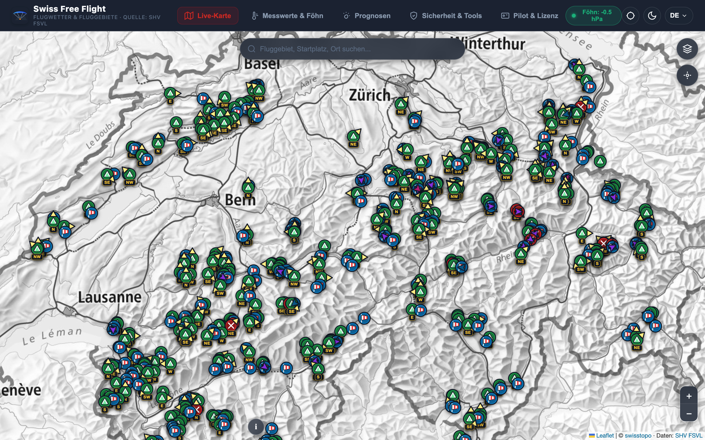](screenshots/01_fluggebiete_overview.png) | [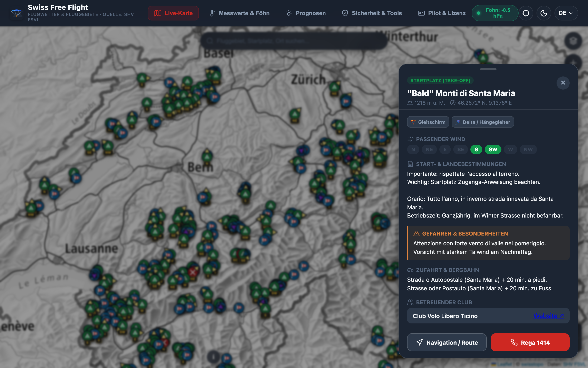](screenshots/02_fluggebiete_startplatz_detail.png) |
| **Landevolte (Landing Circuit) Trajectory** | **Map Layer Controls Drawer** |
| [](screenshots/03_landevolte_circuit_detail.png) | [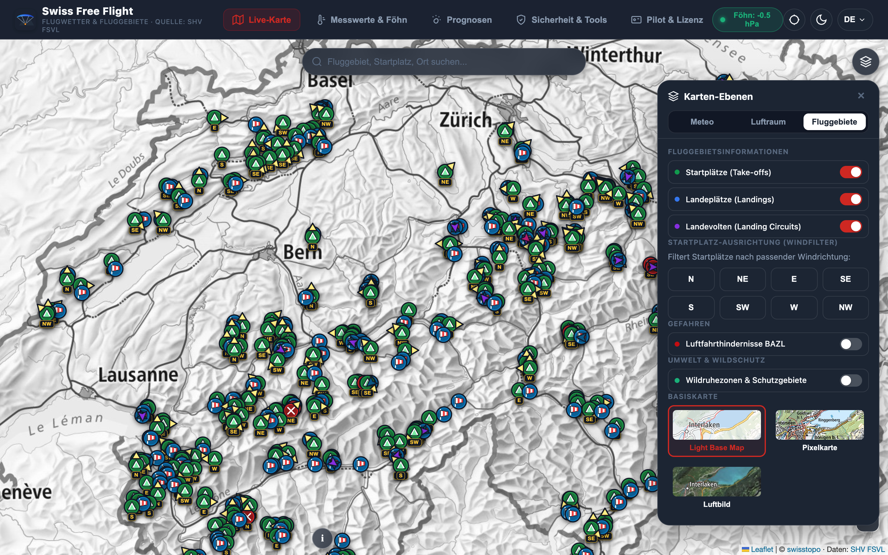](screenshots/04_karten_ebenen_drawer.png) |
| **Swisstopo Satellite Aerial Basemap** | **Aviation Obstacles & Controlled Airspaces** |
| [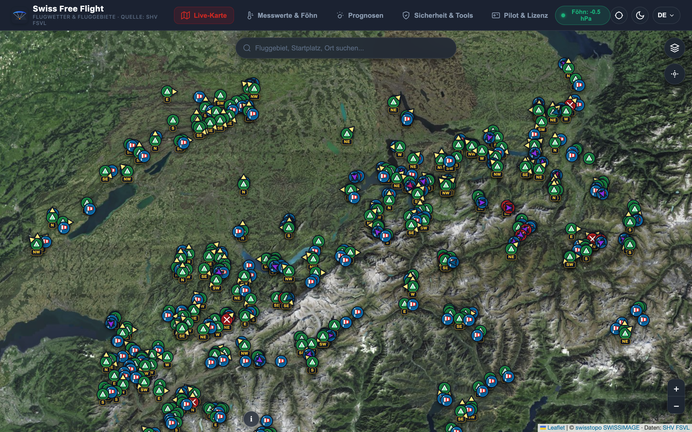](screenshots/05_swisstopo_satellit_ortho.png) | [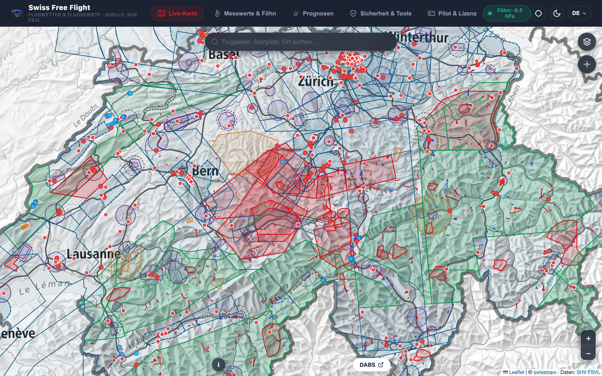](screenshots/06_hindernisse_und_luftraeume.png) |
| **Live Wind Arrows (Swiss & Alpine Borders)** | **Wind Station Observation Popup** |
| [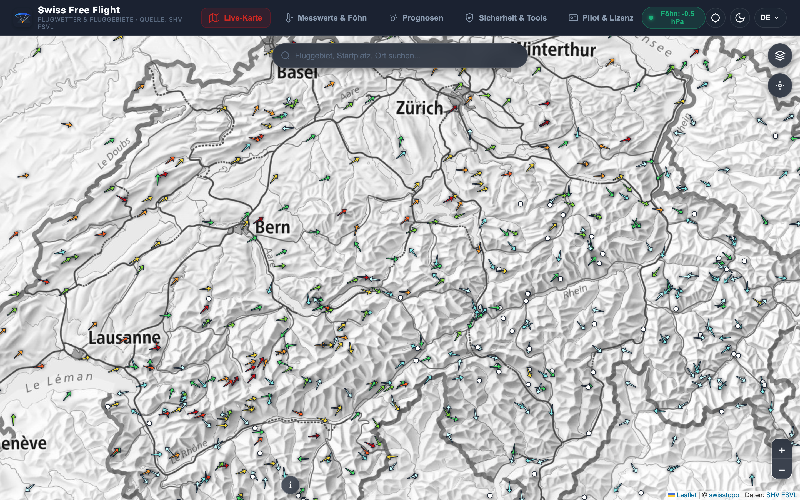](screenshots/07_windstationen_schweiz_international.png) | [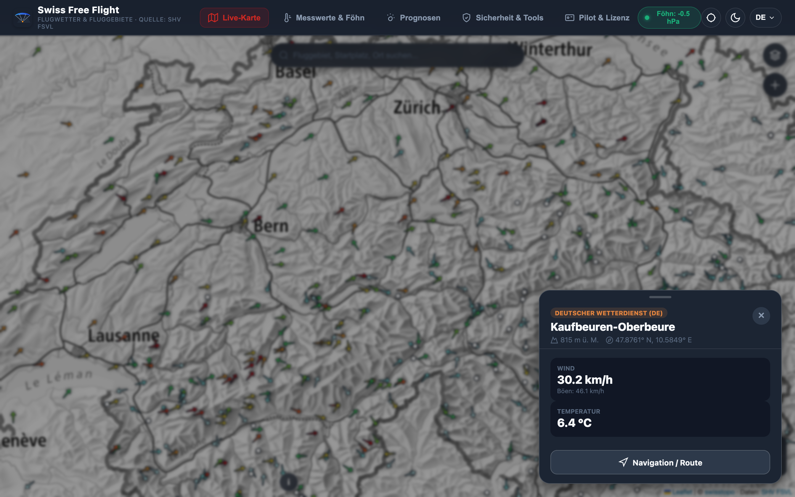](screenshots/08_windstation_messwerte_popup.png) |

### 2. Live Weather Observations & Föhn
| Alpine Föhn & 24h Druckdifferenz Chart | Live Weather Station Observations |
| :---: | :---: |
| [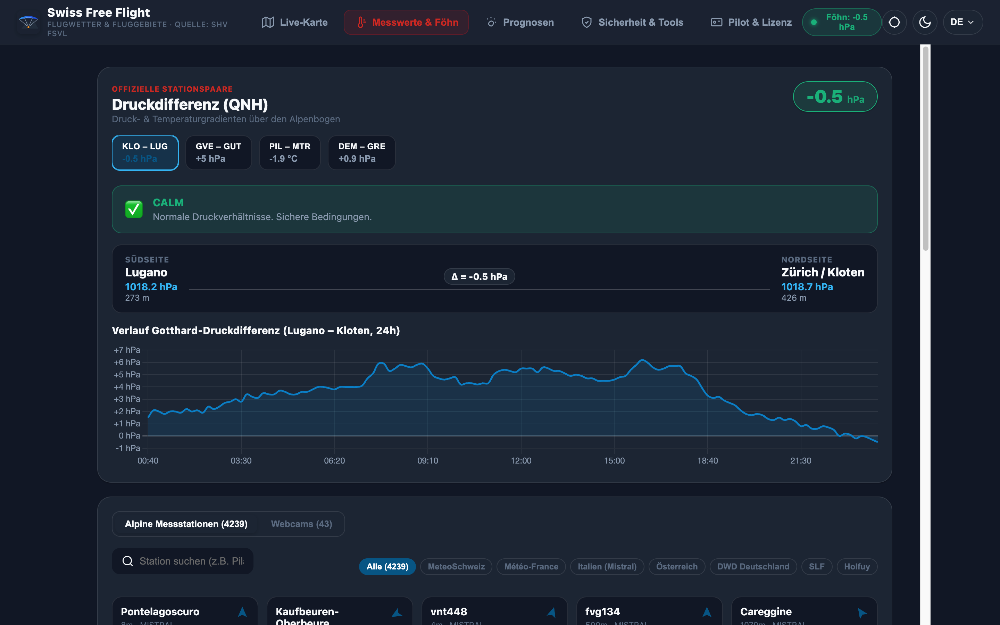](screenshots/09_wetter_druckdifferenz_foehn.png) | [](screenshots/10_wetter_messwerte_stationen.png) |

| Swiss Flying Site Webcams Gallery |
| :---: |
| [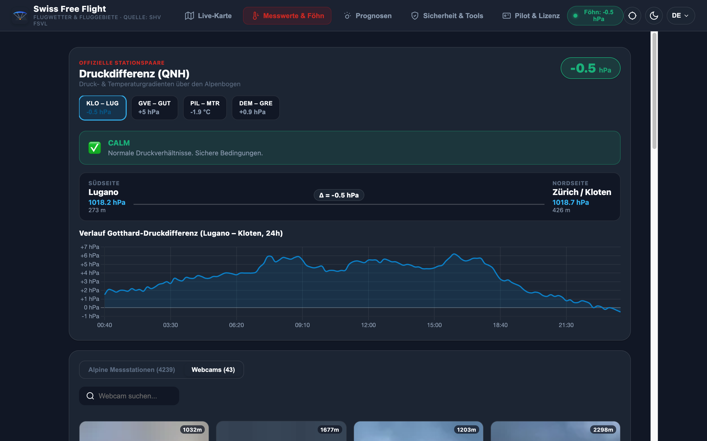](screenshots/11_wetter_webcams_uebersicht.png) |

### 3. Meteorological Forecasts & Soundings
| Alpenwetter Soaring Forecast Bulletins | Aussichten Spatial Map Forecast Overlay |
| :---: | :---: |
| [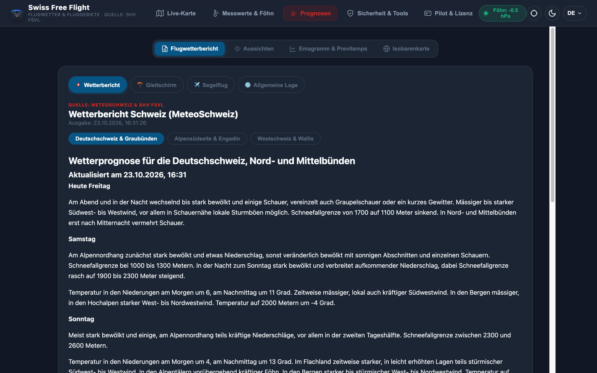](screenshots/12_prognosen_alpenwetter_text.png) | [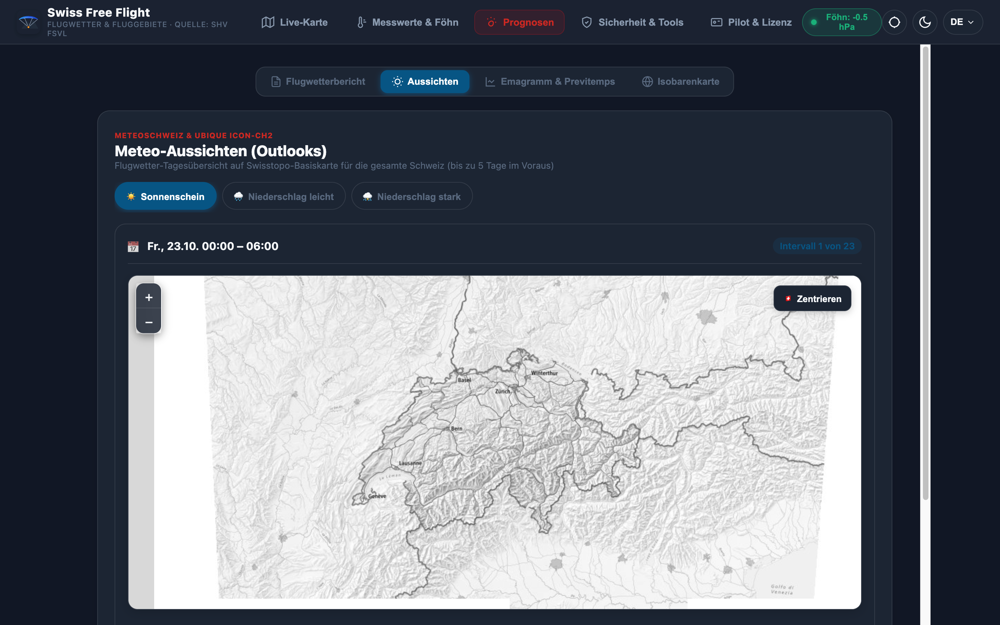](screenshots/13_prognosen_aussichten_karte.png) |
| **Sounding Stations Map (Previtemps / ICON-CH1)** | **Thermodynamic Emagramm Sounding Graph (Interlaken)** |
| [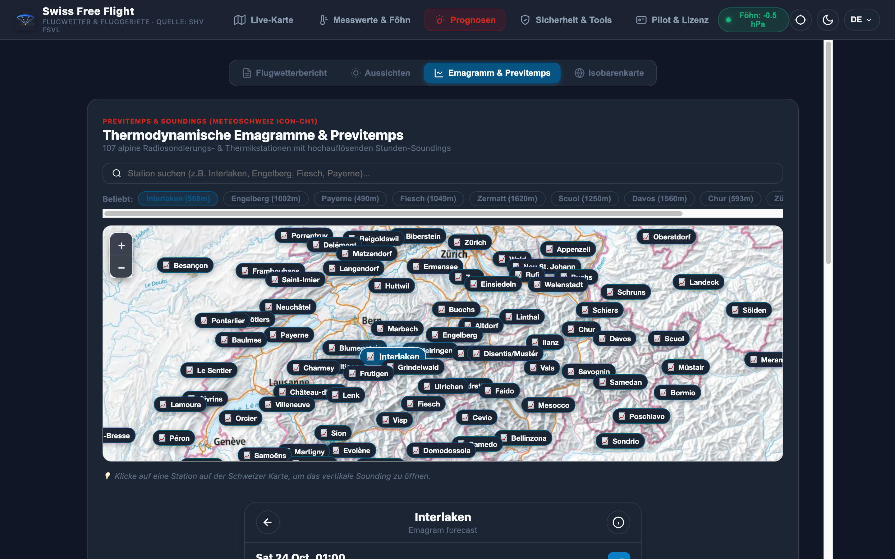](screenshots/14_prognosen_emagramm_standorte_karte.png) | [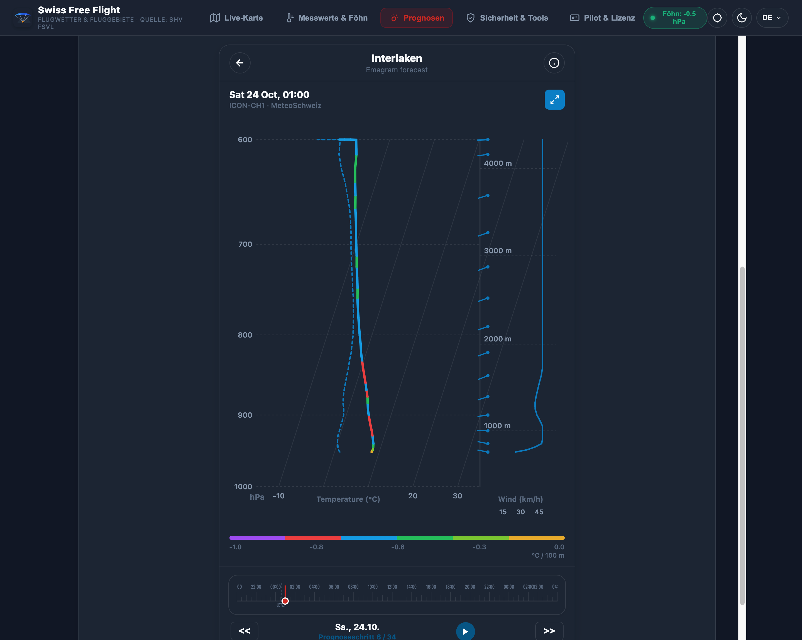](screenshots/15_prognosen_emagramm_sounding_graph.png) |

| Synoptic Surface Pressure Isobar Analysis | Flight Safety & Operations Dashboard |
| :---: | :---: |
| [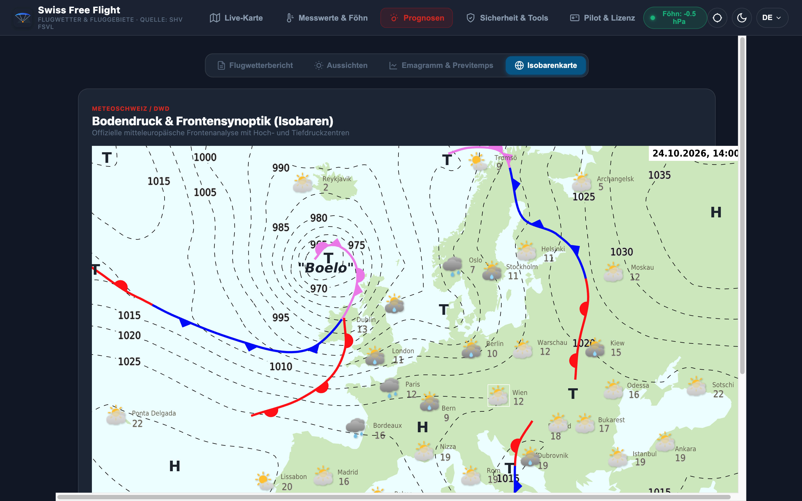](screenshots/16_prognosen_isobaren_karten.png) | [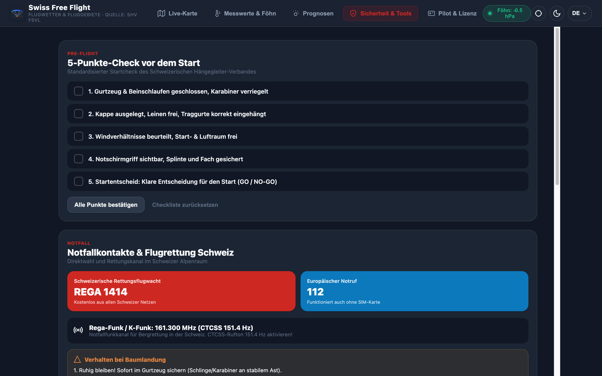](screenshots/17_sicherheit_dabs_und_flugbuch.png) |

---

## Prerequisites

* **Node.js**: v20.x or higher (v22+ supported)
* **npm**: v9.x or higher

---

## Quick Start

### 1. Clone & Install Dependencies

```bash
git clone https://github.com/unbe/ai-shv-app.git
cd ai-shv-app
npm install
```

### 2. Run in Development Mode

The development script starts both the **Vite Frontend Server** (Port `3000`) and the **Express Backend API** (Port `3001`):

```bash
npm run dev
```

Open your browser and navigate to:
```
http://localhost:3000
```

> **Note**: Vite proxies `/api/*` requests directly to `http://127.0.0.1:3001`.

---

## Individual Server Commands

If you prefer running the frontend and backend in separate terminal tabs:

* **Backend API Server only** (Port `3001`):
  ```bash
  npm run server
  ```

* **Frontend Vite Dev Server only** (Port `3000`):
  ```bash
  npm run dev:vite
  ```

---

## Production Build & Preview

To build the client bundle for production:

```bash
npm run build
```

To preview the production build locally:

```bash
npm run preview
```

---

## Running with Docker

You can run the entire application (frontend + backend API + aerological sounding calculations) inside a lightweight container:

### Using Docker Compose (Recommended)

```bash
docker compose up --build -d
```

Open `http://localhost:3000` in your browser.

To stop the container:
```bash
docker compose down
```

### Using Plain Docker

```bash
# 1. Build the production image
docker build -t swiss-free-flight .

# 2. Run the container
docker run -d --name swiss-free-flight -p 3000:3000 swiss-free-flight
```

---

## Automated Screenshots & Chrome DevTools MCP

The repository includes a Puppeteer automation script to capture clean, high-DPI screenshots of all app views:

```bash
node scripts/generate_screenshots.js
```

### Chrome DevTools MCP Server Configuration

For AI coding agents (such as Antigravity, Claude, or Cursor) using the Model Context Protocol (MCP) to interact with Chrome, configure [.agents/mcp_config.json](.agents/mcp_config.json):

```json
{
  "mcpServers": {
    "chrome-devtools": {
      "command": "npx",
      "args": [
        "chrome-devtools-mcp@latest",
        "--wsEndpoint",
        "ws://host.lima.internal:9222/devtools/browser"
      ]
    }
  }
}
```

---

## Project Structure

```
├── public/
│   └── data/                 # GeoJSON datasets (flyingsites, airspaces, obstacles)
├── server/
│   ├── index.js              # Express API server (weather, webcams, soundings proxy)
│   ├── start-dev.js          # Concurrent launcher for API + Vite
│   ├── emagram_provider.js   # Atmospheric soundings provider
│   └── obstacles_provider.js # Aviation obstacles query provider
├── src/
│   ├── components/           # Header, BottomNav, BottomSheet UI components
│   ├── services/             # API client services & variometer audio
│   ├── styles/               # CSS styles & theme definitions
│   ├── views/
│   │   ├── MapView.js        # Leaflet interactive map, sites, circuits, layers
│   │   ├── WeatherView.js    # Föhn pressure difference & weather stations list
│   │   ├── ForecastView.js   # Alpenwetter text, Aussichten overlay, Emagramm
│   │   ├── SafetyView.js     # DABS, safety checklist, logbook, vario
│   │   └── ProfileView.js    # Pilot license & membership profile
│   ├── main.js               # Application entry point & router
│   └── state.js              # Central reactive application state store
├── scripts/
│   └── generate_screenshots.js # Automated screenshot capturing tool
├── screenshots/              # High-DPI screenshots of all application views
├── vite.config.js            # Vite configuration with /api proxy
└── package.json
```

---

## License

Apache-2.0 / SHV FSVL
